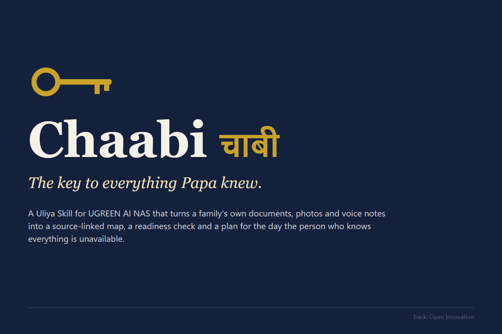
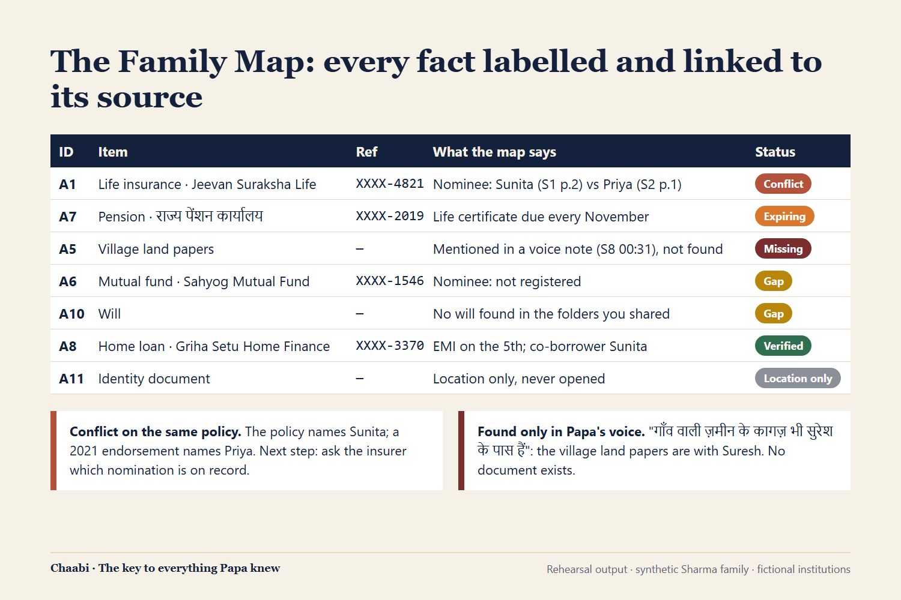

<p align="center"></p>

# Chaabi (चाबी)

**The key to everything Papa knew.**

Chaabi is a Uliya Skill for **UGREEN AI NAS**, built for the UGREEN Hackathon 2026 (track: Open Innovation). It turns the documents, document photos and voice notes a family already keeps on its NAS into a source-linked **Family Map**, a **readiness check**, and a **continuity plan** for the day the person who knows everything is unavailable.

> When the one person who knows where everything is can't tell you, Chaabi reads the papers, photos and voice notes already on your NAS, and shows your family what exists, what's missing, and what to do.

---

## Why

In most families, one person knows where the insurance policies, fixed deposits, property deeds, pension orders and locker keys are, and how they connect. When that person is in hospital, losing their memory, or gone, the family still has the papers but not the context. More than ₹72,000 crore sits unclaimed in the RBI's Depositor Education and Awareness Fund (Rajya Sabha reply, January 2026).

Family-vault apps ask someone to type everything in. Chaabi is **zero-form**: it reads what already exists.

## What it does

| Conversation | Who runs it | Output |
|---|---|---|
| **1. Set up Chaabi** | The owner, after consent | An approved, versioned **Family Map** |
| **2. Check our readiness** | The owner or a permitted family member | Conflicts, items expiring, items missing, facts that are unverified, and what changed |
| **3. What if someone is unavailable?** | A permitted family member | A plan for the first 24 hours, week, 30 days and later, grounded in the family's own documents |

- **Fact labels:** Verified · Unverified · Conflict · Missing. Every fact links to its source file and page, or to the voice-note timestamp.
- **What the map finds:**
  - nominee conflicts on the same policy;
  - papers mentioned in a voice note but found nowhere;
  - premiums and life certificates coming due;
  - missing wills and missing nominees.

<p align="center"></p>

## Privacy by design

- **Owner consent first.** A cloud model, or a "not sure" answer, needs a separate explicit yes; the local model is recommended.
- **Only the folders the owner names.** Document photos are found through the existing photo text index, so personal photos and ID images are never opened.
- **Masked and minimal.** Identifiers show only their last 4 characters (`XXXX-4821`). Passwords, PINs and OTPs are never copied.
- **Originals are read-only.** Every map is a new dated version and nothing is overwritten.
- **Never grants, changes or works around access.** No access means it explains and stops.
- **Every rule maps to a clause** of UGREEN's Skill Content Safety and Publishing Guidelines. See [`docs/rules-audit.md`](docs/rules-audit.md).

## Repository layout

```text
skill/chaabi/              The Skill package (Markdown only; this is what ships)
  SKILL.md                 Goal, inputs, capability evidence, workflow, completion and failure
  references/              Execution contract, Family Map format, situations guide,
                           privacy and consent, disclosures
tests/                     pytest suite (package rules, kit checker, sample data, simulations, ZIP, proposal)
tests/simulations/         Rehearsal harness, six scenarios (S1-S6) and their recorded results
sample-family/             Generator for the synthetic Sharma family (HTML → Playwright → PDF/JPG, TTS voice notes)
scripts/build_zip.py       Builds dist/chaabi.zip (one top folder, sorted, fixed timestamps)
proposal/                  Round 1 proposal (Markdown) and its PDF builder
media/                     Devpost gallery images and the script that renders them
devpost/about.md           Devpost project story
docs/                      Design spec, implementation plan, rules audit, finalist-day run-book
```

## Getting started

Requirements: Windows, macOS or Linux; Python 3.13; Node.js 18+; Git.

1. Install the development environment. On Windows the venv's Python is `.venv/Scripts/python`; on macOS and Linux it is `.venv/bin/python`.

   ```bash
   python -m venv .venv
   .venv/Scripts/python -m pip install -r requirements-dev.txt
   .venv/Scripts/python -m playwright install chromium
   ```

2. Get the official UGREEN Skill Developer Package (uliya-skill-kit 0.7.3) from the hackathon starter kit and unzip it to `~/tools/uliya-skill-kit`, or point `UGREEN_KIT_DIR` at wherever you put it.

3. Run the tests and the official checker:

   ```bash
   .venv/Scripts/python -m pytest -q
   node ~/tools/uliya-skill-kit/scripts/check-skill.mjs skill/chaabi
   ```

   Expected: all tests pass, and the checker reports `"status": "static-pass"` with 0 errors and 0 warnings.

4. Build the submission files:

   ```bash
   .venv/Scripts/python scripts/build_zip.py      # dist/chaabi.zip
   .venv/Scripts/python proposal/build_pdf.py     # proposal/chaabi-proposal.pdf
   ```

5. Generate the synthetic family (optional; `--with-audio` uses edge-tts and needs a network connection):

   ```bash
   .venv/Scripts/python sample-family/generate.py --out sample-family/out --today 2026-11-10 --with-audio
   ```

## How it was tested without a NAS

Round 1 provides no hardware, so Chaabi is rehearsed:

1. A fresh AI agent plays the Uliya runtime, following [`tests/simulations/harness.md`](tests/simulations/harness.md).
2. It reads `SKILL.md` literally and receives scripted results from the NAS agents. It never sees the tests.
3. Deterministic checks in `tests/test_simulations.py` then verify the recorded results: no full ID numbers or passwords, consent before any file is read, the right Conflict, Missing and Gap findings, and versioned saves.

| Scenario | What it proves |
|---|---|
| S1 Set up | Full map from the Sharma family; nominee Conflict; village land Missing; ID card never opened |
| S2 What if Papa is in hospital | Plan quotes the cashless-claim steps and TPA number from the policy, p.6 |
| S3 No access | A family member without access is told why, and nothing else happens |
| S4 Failures | Offline folder, unreadable file and failed searches are labelled, never invented |
| S5 Translation declined | The Hindi original is kept and labelled Not translated |
| S6 Change check | A new file is detected, and a same-day update is saved as version 2 without touching version 1 |

## Status

- **Round 1 package:** complete. 76 automated tests pass, and the official kit checker reports static-pass with 0 errors and 0 warnings.
- **Still needs real-NAS validation (finalist day):** photo text search, extraction from scans, translation approval, save naming, and mixed Hindi-English transcription. See [`docs/finalist-day.md`](docs/finalist-day.md).
- **Planned next:** re-process only changed files, track photo modification dates, and add more Indian languages.

## Disclosures

- **The Skill package** contains no third-party code; it is original Markdown written for this hackathon.
- **Development tools** used only to build and test it: uliya-skill-kit 0.7.3 (UGREEN), Playwright (Apache-2.0), Pillow (MIT-CMU), pypdf (BSD-3-Clause), Markdown (BSD-3-Clause), pytest (MIT), edge-tts (LGPL-3.0).
- **AI tools:** Claude Code (Anthropic) was used for research, drafting, tests and synthetic data.
- **Data:** every person, institution and number in the sample family is invented.
- **Full list:** [`skill/chaabi/references/disclosures.md`](skill/chaabi/references/disclosures.md).

Chaabi is an organiser, not legal or financial advice, and it does not give anyone legal or financial authority.

## Author

Priyanshu Kumar Senapati. No licence has been chosen yet; all rights reserved.
